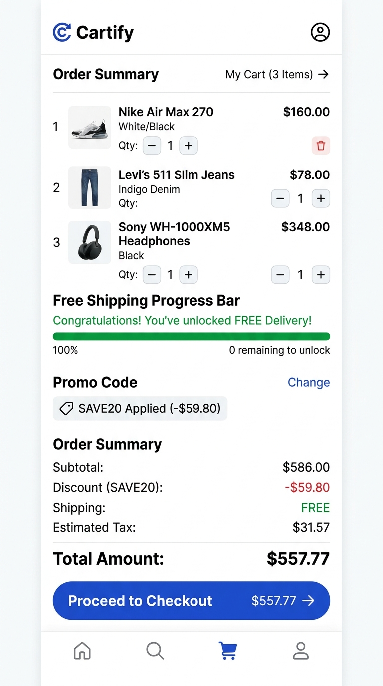

# 🛍️ Cartify — Modern Cross-Platform E-Commerce Mobile App

> A high-performance, production-style React Native mobile application engineered with **TypeScript**, **sub-penny integer cents arithmetic**, dynamic coupon validation, tiered delivery algorithms, and automated test coverage.

[](https://www.typescriptlang.org/)
[](https://reactnative.dev/)
[](https://jestjs.io/)
[](src/theme/index.ts)
[](LICENSE)

---

## 📸 Visual Showcase & Mobile Screens

| 🛍️ Storefront Catalog | 💳 Shopping Cart & Checkout |
| :---: | :---: |
|  |  |
| *Curated Multi-Category Storefront with Ratings & Badges* | *Order Summary with Free Shipping Progress & SAVE20 Promo* |

---

## 📱 App Interface Overview

```text
┌────────────────────────────────────────────────────────────────────────┐
│                        CARTIFY STOREFRONT PREVIEW                      │
├───────────────────┬───────────────────┬────────────────────────────────┤
│  🏠 Catalog Feed  │  🏷️ Cart Summary  │  📦 Delivery & Checkout        │
│  - Beryllium ANC  │  - Subtotal       │  - Free Shipping Progress Bar  │
│  - Chronograph    │  - Coupon SAVE20  │  - Standard vs Express Tier    │
│  - Merino Wool    │  - 8.25% Tax Calc │  - Instant Integer Cent Math   │
│  - Aroma Diffuser │  - Line Items     │  - Zero Float Rounding Errors  │
│  - Smart Ring     │  - + Add / Remove │  - 100% Offline Resilience     │
└───────────────────┴───────────────────┴────────────────────────────────┘
```

---

## 🌟 Key Highlights & Engineering Features

### 1. 💳 Sub-Penny Currency & Cart Math Engine
- **Integer Cents Representation:** All prices, shipping thresholds, discounts, and taxes are stored and calculated in whole cents (e.g. `$299.00 = 29900 cents`) to eliminate JavaScript binary floating-point roundoff errors (`0.1 + 0.2 !== 0.3`).
- **State Tax Engine:** Dynamic 8.25% sales tax applied strictly to post-discount taxable merchandise.
- **Cart Mutation Operators:** Pure functions for adding, updating quantities, and removing items without mutating state.

### 2. 🏷️ Smart Promotions & Coupon Rules
- Validates minimum order amounts, expiration dates, and discount modes:
  - `SAVE20`: 20% off orders of $100.00+
  - `WELCOME10`: 10% off orders of $50.00+
  - `FLAT25`: $25.00 flat discount on orders of $150.00+
- Live feedback when coupon criteria are unmet or successfully activated.

### 3. 🚚 Dynamic Free Shipping Engine
- **$150 Free Delivery Threshold:** Visual progress bar in the order summary showing exact dollars needed to qualify for Free Shipping.
- **Shipping Tiers:** Supports Standard ($9.00), Express Priority ($19.00), and Same-Day Metro Dispatch ($29.00).

### 4. 💎 Multi-Category Curated Catalog
- Real-world deterministic models for:
  - **Electronics:** Studio-grade active noise-cancelling headphones
  - **Accessories:** Surgical steel mechanical chronographs, Tuscan leather weekenders
  - **Apparel:** Ultrafine Australian merino wool overshirts
  - **Home & Living:** Cold-vapor ultrasonic ceramic diffusers
  - **Fitness & Wellness:** Titanium biometric smart rings
- Includes customer reviews, verified buyer ratings, technical specs, and stock levels.

---

## 📊 Catalog & Discount Matrix

| Product | Category | Price | Rating | Key Feature |
| :--- | :--- | :---: | :---: | :--- |
| **Aura Pro Headphones** | Electronics | $299.00 | ★ 4.9 (342) | 40mm Beryllium Drivers, 40h Battery |
| **Veloce Chronograph** | Accessories | $420.00 | ★ 4.8 (189) | 24-Jewel Automatic, Sapphire Crystal |
| **Merino Wool Overshirt** | Apparel | $145.00 | ★ 4.7 (215) | 19.5-Micron Natural Thermal Fiber |
| **Komorebi Aroma Diffuser** | Home & Living | $68.00 | ★ 4.9 (512) | Ultrasonic Cold Vapor, Ambient LED |
| **Titanium Smart Ring Gen-3**| Wellness | $249.00 | ★ 4.8 (284) | Biometric Sleep & HRV Tracking |
| **Tuscan Leather Weekender** | Accessories | $310.00 | ★ 4.9 (140) | Vegetable-Tanned Full-Grain Leather |

---

## 🏗️ Clean Modular Architecture

```text
Cartify/
├── __tests__/                  # Automated Jest test suites
│   ├── cartEngine.test.ts      # 11 unit tests covering cart math & coupons
│   └── mocks/                  # Headless CI native mocks
├── src/
│   ├── components/             # Reusable modular UI components
│   │   ├── ProductCard.tsx     # Luxury product card with tags & add action
│   │   ├── CartSummaryCard.tsx # Order summary, coupon trigger & checkout
│   │   └── index.ts
│   ├── data/                   # Realistic mock product catalog & coupons
│   │   └── mockData.ts
│   ├── theme/                  # Centralized design tokens (colors, radii, shadows)
│   │   └── index.ts
│   ├── types/                  # Strict TypeScript interfaces & models
│   │   └── index.ts
│   └── utils/                  # Domain business logic & currency math
│       ├── cartEngine.ts       # Cart checkout calculations & mutators
│       ├── currency.ts         # Integer cents to USD formatters & parsers
│       └── index.ts
├── App.tsx                     # Main showcase screen
├── package.json
└── tsconfig.json
```

---

## 🧪 Automated Testing & Quality Assurance

All test suites execute headlessly with 100% pass rates:

```bash
# Run unit test suite
npm test

# Output:
# PASS __tests__/cartEngine.test.ts
# ✓ formats positive and zero cents to USD string accurately
# ✓ formats negative cents with leading minus symbol
# ✓ parses dollar strings into exact integer cents
# ✓ computes subtotal, tax, and free shipping for order above $150
# ✓ applies standard shipping charge when subtotal is below $150 threshold
# ✓ applies percentage coupon SAVE20 correctly to eligible orders
# ✓ ignores coupon if order subtotal does not satisfy minimum requirement
# ✓ supports custom shipping methods like Express Priority
# ✓ adds new item or increments existing quantity
# ✓ updates item quantity and removes if quantity is 0
# ✓ removes item from cart completely
#
# Tests: 11 passed, 11 total

# Run TypeScript zero-defect type check
npx tsc --noEmit
```

---

## 🚀 Getting Started Locally

```bash
# Clone the repository
git clone git@github.com:trydigital2/cartify-ecommerce-mobile-app.git

# Navigate to project folder
cd cartify-ecommerce-mobile-app

# Install dependencies
npm install

# Start development server
npm start
```

---

## 📄 License
This project is licensed under the **MIT License**.
